# FlowGS 论文精读与四项拆解

论文：Jiangwei Mo、Xi Lu、Hanlin Wu，*Flow-based Gaussian Splatting for Continuous-Scale Remote Sensing Image Super-Resolution*，arXiv:2605.22147v1。阅读范围是用户提供的 5 页原文、4 幅图、3 张表、18 个公式、作者脚注与参考文献；本次没有获取到单独的补充材料。本文标注“原文”是作者报告的内容；“分析”是依据原文作出的解释，不代表作者曾按此顺序实际思考或试验。

**一句话理解：** 给定一张低分辨率遥感图像和目标倍率，FlowGS 先用受低分辨率图像条件约束的 Flow Matching（流匹配）生成紧凑的细节潜变量，再把它与低分辨率特征、目标倍率融合，通过二维高斯聚合生成超分辨率图像。论文的主张是：这条路线能在所测试的数据集和条件下，以单步细节生成兼顾感知质量和速度，并支持多个放大倍率。[来源：p.2 Fig. 2；p.3 Eq. 9–18；p.4 Table I–II]

## 一、作者在解决什么矛盾

遥感图像往往需要按不同目标尺寸放大。传统固定倍率模型常常要为 2 倍、4 倍等倍率分别训练；连续倍率方法则希望一个模型覆盖 2.6 倍、3.4 倍等非整数倍率。另一方面，低分辨率图像缺失了不少高频信息，仅有输入图像通常不能唯一决定高分辨率细节：同一块模糊区域可能对应多种清晰纹理。[来源：p.1 S002–S005]

论文描述了两类路线的取舍：

- **连续表示或回归方法**可以灵活查询位置，但作者认为某些方法的纹理恢复受限；GaussianSR 使用连续高斯场改善表示，仍被作者描述为确定性回归。
- **扩散生成方法**能够建模细节分布，但通常需要多次迭代。这里“可能生成逼真的细节”与“找回真实存在的细节”是不同要求，论文主要报告感知指标。

作者的设计假设可以重建为：**将较确定的低分辨率结构和较不确定的细节生成分开；对细节用较快的生成方法，再用连续高斯表示处理输出倍率。** 这是对论文结构的分析，不是作者完整研发历史的证明。作者没有说明具体先尝试、放弃了哪些方法。[来源：p.1 S003–S006；p.2 Fig. 2]

## 二、一张图看完整流程

下图是论文自己的方法图。上半部分为推断，下半部分为训练。

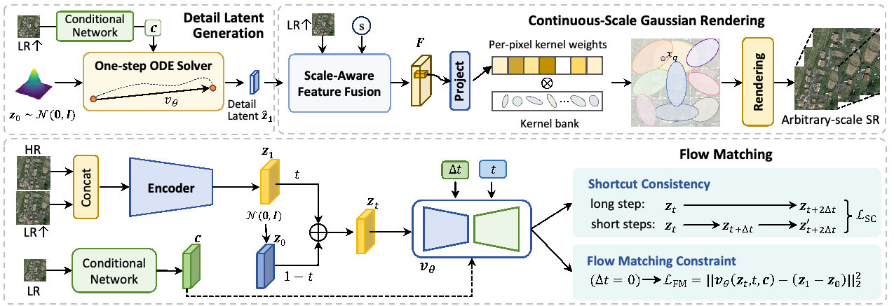

**推断过程：**

1. 用户提供低分辨率图像 LR 和目标倍率。例如：一张遥感图像放大 3.4 倍。
2. 条件网络从 LR 中提取结构信息 c；同时从噪声分布采样初始潜变量 z₀。
3. 速度网络根据噪声、时间、条件等预测更新方向。论文通过 shortcut consistency（捷径一致性）训练，使推断时可用一次欧拉更新生成细节潜变量 ẑ₁。
4. 解码器融合 ẑ₁、LR 特征与倍率 s，得到尺度感知特征场 F。
5. 特征预测各位置的高斯核参数；在目标坐标处聚合高斯特征、预测图像残差，最后加到双三次上采样的 LR 图像上，得到 SR 图像。

**训练过程：** 输入高分辨率真值 HR 与上采样的 LR，先通过编码器得到目标细节潜变量 z₁；模型再学习从噪声到这个目标的传输。训练时有 HR 真值，实际推断时没有。[来源：p.2 E001–E005；p.3 E006–E018]

需要区分：**FM 不直接产生最终整张图，也不是直接物理推动高斯核。** 它生成潜变量，经过融合后影响后续高斯参数预测与渲染。论文中的“一步”指流生成部分一次函数求值；整个系统仍有条件网络、解码和渲染等计算。[来源：p.3 E009–E010、S028]

## 三、为什么这样设计：作者的取舍与证据

### 1. 为什么只生成细节潜变量？

**作者给出的理由：** 超分辨率输入已经携带一部分结构，因此将生成任务集中到缺失细节，而不是从噪声重新生成整张图。目标潜变量由 HR 与上采样 LR 拼接后编码得到；文中希望它与后续高斯渲染对齐。[来源：p.2 S012–S015；E001]

**要注意：** 该潜变量由神经网络学习得到，论文把它设计为细节表示，并不等于数学上已严格证明其只含高频、完全不含低频。论文没有给出单独的频谱分解验证。

**实验证据：** Table III 在 AID-tiny、单步推断下移除 Flow：4 倍时 FID 从 19.43 变为 22.30（越低越好），8 倍时从 53.23 变为 58.95；但 4 倍 LPIPS 从 0.195 变为 0.174，反而更低。因此，此对照支持“生成分支在这些设置下改善 FID”，不支持“所有质量指标都变好”，也不能单独证明其改善像素保真度。[来源：p.5 T003]

### 2. 为什么用 Flow Matching，为什么还要 shortcut？

**作者的思路：** FM 学习噪声到目标细节潜变量的速度场。普通 FM 即使使用线性插值训练，也不自动保证一次大步就能准确到达终点；作者增加 shortcut consistency，让“一次长跳”的速度预测与“两次短跳”的平均速度尽量一致，再以一欧拉步进行推断。[来源：p.2 E003–E005；p.3 E006–E009]

**证据：** 在同一 Table III，移除 SC 后，4 倍 FID 从 19.43 变为 23.29，8 倍从 53.23 变为 58.38；8 倍 LPIPS 从 0.333 变为 0.359，但 4 倍 LPIPS 从 0.195 变为 0.185。这个对照说明，在报告的配置下 SC 对 FID 与 8 倍 LPIPS 有帮助；不能说它对所有指标都提高，更不能仅凭此证明没有其他单步方案能够做到同样效果。[来源：p.5 T003]

### 3. 为什么使用高斯泼溅？

高斯核在空间中有连续的响应；给定目标坐标，可以聚合附近基元的贡献。论文将每个位置关联到可学习高斯核库，并用融合特征预测核权重，再从目标坐标渲染连续特征。这样，**同一模型可根据请求的倍率生成不同网格上的结果**。[来源：p.3 E010–E017]

与 INR 的对比，作者的论述是：许多 INR 方法仍依赖离散特征网格及插值，可能影响空间连续性；高斯场是作者选择的一种连续表示方式。**这不意味着 INR 无法做连续查询，也不意味着高斯表示一定不需要任何离散网格。** [来源：p.1 S003–S004]

### 4. 为什么最后加回上采样图？

输出由“双三次上采样的 LR + 网络预测残差”组成。结构性的直观解释是：先保留一个由输入图像确定的基础，再让网络预测需要修正的部分。论文给出这一构造，但未独立消融它相对直接输出全图的效果；因此“该选择具体带来多少改善”未得到单独验证。[来源：p.3 E016–E017]

## 四、哪些组件有证据支撑，哪些还不能判定

| 组件 | 设计目的 | 根据论文能作出的判断 |
|---|---|---|
| FM 细节生成分支 | 为重建提供生成式细节先验 | **有贡献的证据**：消融中两个倍率的 FID 均更好；4 倍 LPIPS 却更差。不能称所有指标都提升。 |
| Shortcut consistency | 支持较大步长尤其单步生成 | **有贡献的证据**：消融中的 FID 和 8 倍 LPIPS 较纯 FM 更好；4 倍 LPIPS 没有更好。不能证明是唯一可用单步方案。 |
| 二维高斯渲染／核库 | 连续空间表示与任意倍率渲染 | 是本方法的定义性模块，但**没有报告同等条件下替换为 INR 或其他渲染器的单独消融**，不可判定不可替代或其独立收益。 |
| LR 条件网络 | 利用输入结构引导潜变量生成 | 文中说明了作用，未看到移除条件网络的独立消融；具体贡献未隔离。 |
| 尺度感知融合 | 结合倍率、LR 与生成潜变量 | 对所述流程承担连接作用；未给出替换融合方式的独立对照。 |
| 残差输出与双三次基底 | 以插值结果为基础预测修正 | 公式明确，但没有报告与直接预测整图的专门消融。 |
| 100 个核、7×7 区域、特定 U-Net | 当前实现的参数选择 | 文中给出设置，未看到核数、窗口大小和骨干架构的系统对照；不能据此声称这些具体数值不可替代。 |

“未证明不可替代”不是说该组件没有用，而是**现有消融不够将它的独立贡献与其他设计分开**。[来源：p.3 S042；p.5 Table III]

## 五、核心公式：用能手算的小例子理解

以下数字全部是**为教学人为构造的例子**，不是论文实验数据。图片是原文公式；原文里的向量、张量常被简化为单个数来展示计算。

### 例 1：什么是流匹配的直线路径？（式 3、4）

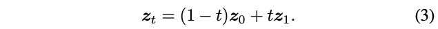

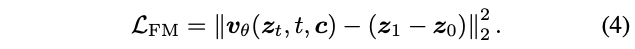

**作用与符号：** z₀ 是初始噪声潜变量，z₁ 是训练时由 HR–LR 图像对编码得到的目标潜变量，t 在 0 到 1 之间，zₜ 是插值状态。真实模型中它们是同形状的潜变量张量；c 是 LR 条件，vθ 是预测速度的网络。式 3 给出训练路径，式 4 让预测速度接近目标方向 z₁−z₀。

**一维例子：** 假设 z₀＝2、z₁＝6，取 t＝0.25，则 zₜ＝0.75×2＋0.25×6＝3。目标速度是 6−2＝4。如果网络预测速度为 3，则单个标量的平方误差为 (3−4)²＝1。

它说明模型在训练时学习从起点指向终点的速度；**这不自动保证学到的整体轨迹可以用一步准确求解**，因此作者又加入 shortcut 一致性。

### 例 2：两小步怎样监督一大步？（式 5–7）

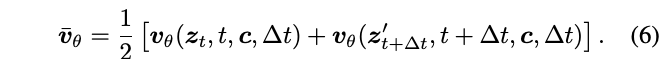

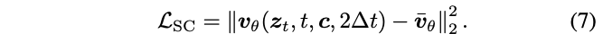

**作用与符号：** Δt 是小步长度；网络可以以状态、时间、条件和步长为输入，预测该步速度。论文比较两次小步的平均速度与一次长度为 2Δt 的大步预测速度，用平方差作为一致性目标。

**一维例子：** 从 zₜ＝1 出发，设 Δt＝0.25，第一次预测速度 2，则一步后的状态为 1＋2×0.25＝1.5。若在 1.5 处第二次预测速度为 4，两步的平均速度为 (2＋4)/2＝3。如果网络对一次大步 0.5 预测的速度为 2.5，一致性误差为 (2.5−3)²＝0.25。对应位置：两小步走到 1.5＋4×0.25＝2.5；当前大步走到 1＋2.5×0.5＝2.25。训练推动这两种预测更一致。

这里只是说明计算，并不保证任意训练出的网络都能让误差为零。论文在每个训练批次中，对四分之一样本使用 shortcut 目标，其余使用标准 FM 目标。[来源：p.3 S023]

### 例 3：什么叫单步生成？（式 9）

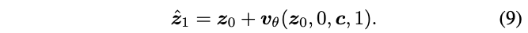

**作用与符号：** z₀ 是推断时采样的初始噪声，c 来自输入图像；网络直接预测从 t＝0 跨到终点的大步速度，得到 ẑ₁。

**一维例子：** 如果 z₀＝2、网络输出速度 3.5，那么单步结果 ẑ₁＝2＋3.5＝5.5。它是一个生成的潜变量，还要经过融合和渲染。这里“一步”只计这个流更新，不包括其余网络与图像输出计算。[来源：p.3 E009–E010]

### 例 4：高斯核如何在候选之间加权？（式 12、13）

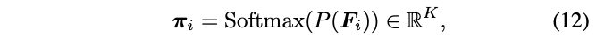

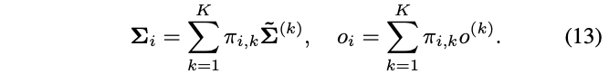

**作用与符号：** 在位置 i，预测头和 Softmax 给出核库权重 πᵢ；每个候选核有协方差 Σ 和不透明度 o。协方差描述二维核的空间范围与方向，是 2×2 矩阵；不透明度是标量。原文实际使用 100 个候选核。

**一维简化例子：** 假设只有两个候选核，其方差分别为 1 和 5，不透明度分别为 0.8 和 0.4；网络给的权重是 0.75 和 0.25。则组合方差为 0.75×1＋0.25×5＝2；组合不透明度为 0.75×0.8＋0.25×0.4＝0.7。实际论文用二维协方差矩阵加权；此例仅用一维方差展示相同的加权运算。权重如何由网络得到，需要训练，不能从这个例子推断。

### 例 5：连续位置怎样聚合多个高斯？（式 14、15）

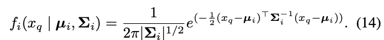

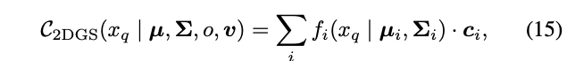

**作用与符号：** xq 是待查询的二维坐标；每个高斯基元有中心 μᵢ、协方差 Σᵢ、不透明度 oᵢ 和特征向量 vᵢ。式 14 给出当前位置对该核的空间响应；式 15 将各个核的响应乘以对应特征贡献后求和。原式是**加权求和，未在该式中写出按响应和归一化**。

**一维简化例子：** 某个查询点附近有两个核，已算出的空间响应分别是 0.5 和 0.2；它们的不透明度分别为 0.8、0.5；假设只有一个特征通道，特征值分别为 2、3。那么两个贡献分别是 0.5×0.8×2＝0.8 和 0.2×0.5×3＝0.3，聚合结果是 0.8＋0.3＝1.1。换一个查询坐标，响应值通常也会变化，因此可以在不同位置计算特征。例子里的 0.5 和 0.2 是预先假设的响应，不是从二维公式推算得来。

### 例 6：残差怎样变成输出图像？（式 16、17）

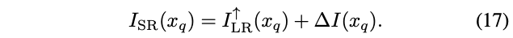

双三次上采样得到基础图像；预测器根据高斯聚合特征生成残差，再逐位置相加。假设某位置的基础像素值为 0.40，网络预测残差为 0.08，则最终输出为 0.48。若预测残差是 −0.08，结果就是 0.32。这个数值例子不表示论文规定像素一定归一化到 0–1，也不证明最终值一定被裁剪到该范围。[来源：p.3 E016–E017]

## 六、看图表：结果支持到哪一步

### 图 1：作者要表达质量和效率的折中

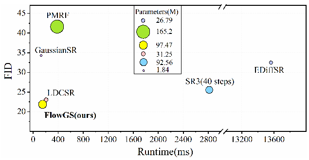

图 1 的 FID 来自 DIOR 的 4 倍 SR；时间在 RTX 4090 上对 512×512 图像测量。纵轴 FID 越低越好，横轴运行时间越短通常越好，圆大小表示参数量。**横轴断开**，约 2,800 后跳到 13,200，不能按整条轴均匀估读。图里 FlowGS 的 FID 与时间优于部分列出的模型，但不同图中的测速协议及整条流水线计时细节披露有限，不能将图上所有差异视为统一可复现的硬件结论。[来源：p.1 F001/C001；p.4–5 S049]

### 表 I：连续倍率并非每个指标都领先

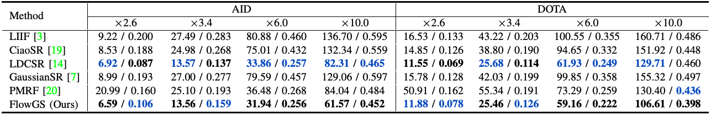

每格顺序是 **FID／LPIPS，均越低越好**。例如 AID 2.6 倍：FlowGS 的 FID 6.59 优于 LDCSR 的 6.92，但 LPIPS 0.106 高于 LDCSR 的 0.087；DOTA 2.6 倍：FlowGS 的 FID 11.88 高于 LDCSR 的 11.55，LPIPS 0.078 高于 LDCSR 的 0.069。不能把“多数设置下 FID 最优”扩写为“所有数据集和指标都最优”。[来源：p.4 T001]

### 表 II：固定倍率和连续倍率方法并列比较

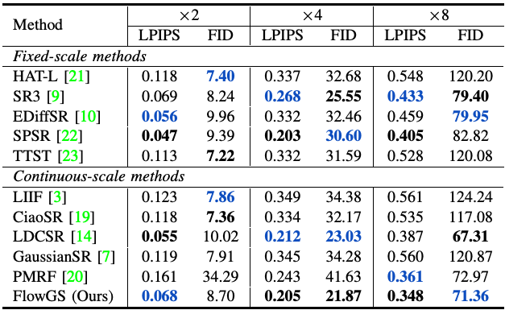

DIOR 的 4 倍下，FlowGS 的 LPIPS／FID 是 0.205／21.87，LDCSR 是 0.212／23.03；8 倍下，FlowGS 为 0.348／71.36，LDCSR 为 0.387／67.31：前者 LPIPS 更低，后者 FID 更低。固定倍率模型为各倍率独立训练，而连续倍率方法用一个模型覆盖倍率；表格中的指标比较应和训练条件一起读。[来源：p.4 T002、S046]

### 图 3：视觉实例提供直观对比

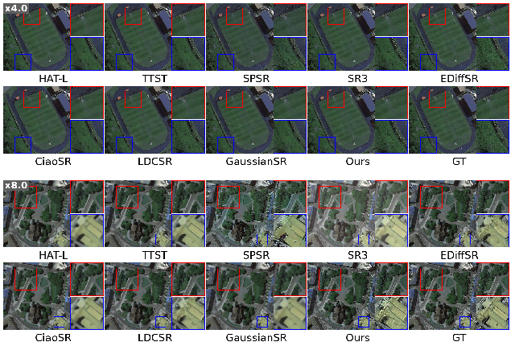

图 3 展示 AID 上 4 倍与 8 倍实例，作者认为 FlowGS 的边缘与纹理更接近真值。图中是挑选展示的视觉样例；文中没有报告盲选流程或读者评价，不能仅凭图推断对全部影像都更真实。视觉上更锐利也不自动证明高频细节来自真实观测。[来源：p.4 F003/C003、S048]

### 表 III：消融提供的支持是指标相关的

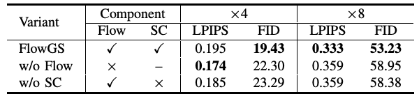

这是 AID-tiny、单步、4 倍与 8 倍设置下的结果，基于 30 张 AID 测试图像的中心裁剪。移除 Flow 或 SC 的 FID 均变差，但 4 倍 LPIPS 反而更低。它能说明两个设计在这些实验条件下对 FID 的贡献，不能说明它们在所有指标、任意数据集、其他倍率上均有效。文中称各变体在相同设置下重新训练，但没有报告重复随机种子的方差。[来源：p.3 S041；p.5 T003]

### 图 4：更多步数有成本，且数值不严格单调

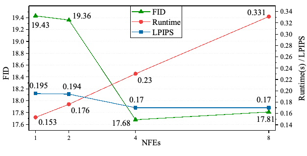

图示 1、2、4、8 次函数求值的质量与运行时间。FID 从 1 NFE 的 19.43 降到 4 NFE 的 17.68，8 NFE 为 17.81；LPIPS 从 0.195 降到约 0.17，并在 4 与 8 步持平（按图中显示精度）。因此数据支持“少数步之后改善趋小”的观察，但 **FID 在 4→8 步并未继续下降**，不应理解为严格单调。论文把 1 步作为速度与质量之间的默认取舍；这不是说 1 步在质量上最好。[来源：p.5 F004/C004]

## 七、实验条件与结论边界

**论文做了什么：** 使用 AID 训练／验证／测试，AID 为 8,000／1,000／1,000 张；DOTA 和 DIOR 各随机选 500 张做跨数据集测试；AID-tiny 从 AID 测试集随机选 30 张并中心裁剪。两个训练阶段在线使用双三次下采样，训练倍率从 1 到 8 均匀采样；表 I 还报告 10 倍结果。模型在单张 RTX 4090 上运行，生成部分默认单步。[来源：p.3 S041–S043；p.4 S044–S045]

**能支持的范围：** 在论文报告的合成退化、数据划分、倍率与指标下，FlowGS 对比方法取得了有竞争力的感知结果；表 III 显示细节生成与 SC 对部分指标有贡献；表 I 的 10 倍结果显示了一个超出训练倍率上限的测试点。它不意味着任意倍率、任意遥感成像条件下都有同等表现。

**仍有的不确定性：**

- **真实退化：** 训练使用双三次下采样。论文未来工作提到真实退化；这篇附件没有给出充分的真实传感器退化验证。
- **物理真实性：** FID 和 LPIPS 看感知分布／特征相似度，不能证明细小纹理逐像素真实。正文未报告 PSNR、SSIM，也未报告检测、分割等下游遥感任务效果。
- **对比公平性：** 文中说固定倍率模型针对每个尺度分别训练、消融变体使用相同设置；但各对比模型的全部训练预算、调参范围、预训练来源及硬件测时细节未完整报告，公平性不能全面确认。
- **统计稳定性：** 正文表格没有提供多随机种子的均值、标准差或置信区间；不能推断差异的统计稳定性。没有看到完整的测试集调参或去重审计说明，也不能据此断言存在泄漏。
- **潜变量可解释性：** 目标潜变量由 HR 和 LR 拼接经编码器学习得到，其“只表示高频细节”的严格分离没有被独立证实。
- **二维到三维／MRI：** 原文为二维遥感图像；未在 MRI、心脏 cine、三维体数据、真实采集或临床任务上验证，也未提供 MRI 物理测量一致性证据。
- **复现细节：** 附件没有提供正式代码或权重入口；核库与网络部分实现、训练监控及检查点选择细节仍需结合代码确认。图 1 时间和 FID 的实验条件不同维度，不能直接当作所有平台的速度结论。

## 八、按四项拆解论文

| 项目 | 具体内容 |
|---|---|
| **研究对象** | 二维遥感影像的任意／连续倍率超分辨率。输入是低分辨率遥感图像和目标放大倍率，输出是对应尺度的重建图像；实验包含 AID、DOTA 和 DIOR。 |
| **核心概念** | 超分辨率、低／高分辨率图像、连续倍率、细节潜变量、条件 Flow Matching、shortcut consistency、2D Gaussian Splatting、高斯核聚合、NFE、FID 和 LPIPS。 |
| **方法** | 两阶段训练：先以 HR–LR 图像对学习细节潜变量及连续高斯渲染；再学习有 LR 条件的潜变量流，并用捷径一致性辅助大步更新。推断时以单步流生成细节潜变量，结合 LR 与目标倍率，进行高斯聚合、残差预测并输出图像。 |
| **结论** | 论文报告，在所列数据集、双三次合成退化和评估指标下，方法可覆盖多个倍率，并以单步细节生成取得有竞争力的 FID、LPIPS 和推断效率。结果存在指标间取舍；尚不能推广为 MRI 有效、真实纹理可恢复或所有指标都最优。 |

## 九、读完应带走什么，以及接下来问什么

这篇论文的机制链条可以记成：**条件流生成细节 → 与输入结构和倍率融合 → 高斯连续聚合 → 预测残差输出。** 论文中最具体的消融支持来自 Flow 与 SC 对 FID 的贡献；高斯模块的独立不可替代性和真实退化鲁棒性仍未被同等条件的消融或实验充分确认。

如果以后考虑 MRI，可先把它当作待验证假设：输入是真实低分辨率 MRI 时，细节潜变量是否改变病灶或解剖结构？目标体素尺寸、各向异性和切片间一致性如何建模？单步后的输出如何与实际测量保持一致？这些问题需要 MRI 数据、物理模型及独立实验回答，不能直接从遥感结果推出。

相关材料：[中英对照易读版](FlowGS_中英对照_易读版.md) · [论文原文](Flow-based_Gaussian_Splatting_for_Continuous-Scale_Remote_Sensing_Image_Super-Resolution.pdf) · [来源映射](source_map.json)。
