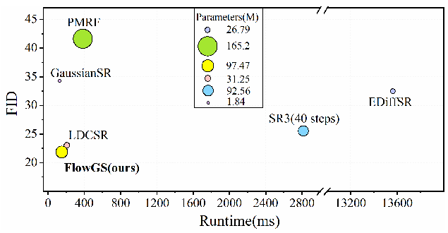
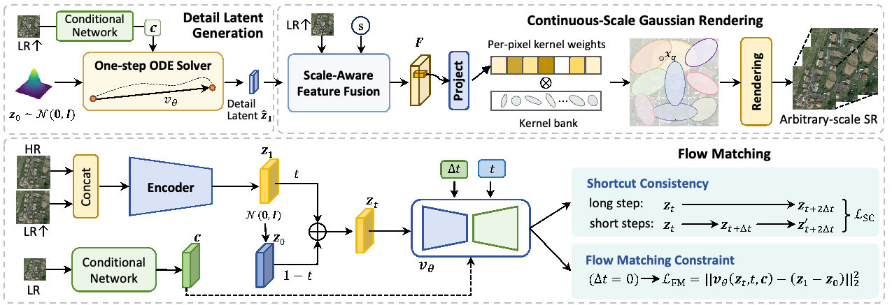
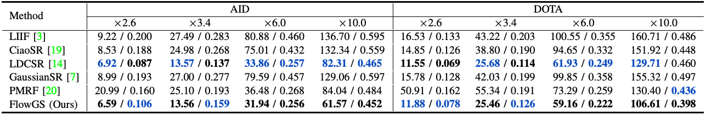
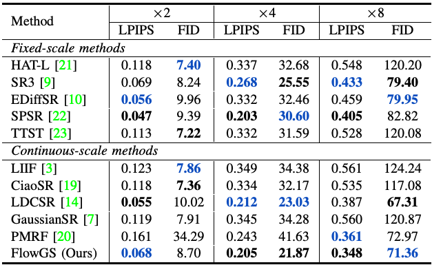
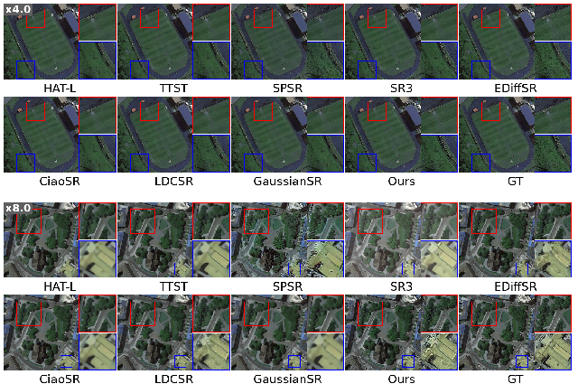
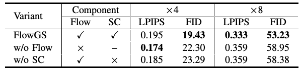
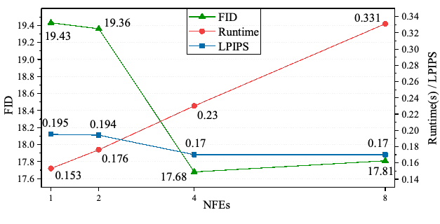

# FlowGS 全文中英对照阅读稿

**Source:** p.1 M001

**Original:** Flow-based Gaussian Splatting for Continuous-Scale Remote Sensing Image Super-Resolution. Jiangwei Mo, Xi Lu, Hanlin Wu, Member, IEEE.

**中文:** 基于流的高斯泼溅：连续倍率遥感影像超分辨率。作者：Jiangwei Mo、Xi Lu、Hanlin Wu（IEEE 会员）。

- 原始附件：[FlowGS PDF](Flow-based_Gaussian_Splatting_for_Continuous-Scale_Remote_Sensing_Image_Super-Resolution.pdf)；5 页，arXiv v1，2026-05-21。
- DOI：[10.48550/arXiv.2605.22147](https://doi.org/10.48550/arXiv.2605.22147)。本稿以用户提供的 PDF 为准；同版本 arXiv HTML 仅辅助恢复双栏阅读顺序与数学源码。
- 译文日期：2026-10-28。S 为正文，C 为图表标题，F 为图，T 为表，E 为公式，R 为参考文献，M 为元信息。页码指附件 PDF 的实际页序。
- 跨页段落为保持语义完整合并显示，并标记页码范围；原图表插在首次实质性讨论附近，源页码单独标注。

## 页码索引

[第 1 页](#page-1) · [第 2 页](#page-2) · [第 3 页](#page-3) · [第 4 页](#page-4) · [第 5 页](#page-5)

## 公式索引

- [E001 · 式（1）](#E001)：第 2 页
- [E002 · 式（2）](#E002)：第 2 页
- [E003 · 式（3）](#E003)：第 2 页
- [E004 · 式（4）](#E004)：第 2 页
- [E005 · 式（5）](#E005)：第 2 页
- [E006 · 式（6）](#E006)：第 3 页
- [E007 · 式（7）](#E007)：第 3 页
- [E008 · 式（8）](#E008)：第 3 页
- [E009 · 式（9）](#E009)：第 3 页
- [E010 · 式（10）](#E010)：第 3 页
- [E011 · 式（11）](#E011)：第 3 页
- [E012 · 式（12）](#E012)：第 3 页
- [E013 · 式（13）](#E013)：第 3 页
- [E014 · 式（14）](#E014)：第 3 页
- [E015 · 式（15）](#E015)：第 3 页
- [E016 · 式（16）](#E016)：第 3 页
- [E017 · 式（17）](#E017)：第 3 页
- [E018 · 式（18）](#E018)：第 3 页

## 术语表

| 英文／缩写 | 统一中文 | 备注 |
|---|---|---|
| FlowGS | 保留模型名 | 不与同名三维重建项目混用 |
| flow matching (FM) | 流匹配 | 统一译名 |
| shortcut consistency (SC) | 捷径一致性 | 保留 SC 缩写 |
| Gaussian splatting | 高斯泼溅 | 保留 Gaussian Splatting 英文便于检索 |
| continuous-scale / arbitrary-scale SR | 连续倍率／任意倍率超分辨率 | 按原文用词保留区别 |
| detail latent | 细节潜变量 | 区别于原始图像与细节先验 |
| Gaussian primitive | 高斯基元 | 包含中心、协方差、不透明度和特征 |
| opacity | 不透明度 | 不译作透明度 |
| NFE | 函数求值次数 | 不等于整套系统全部网络调用次数 |
| LPIPS | 学习式感知图像块相似度 | 数值越低越好 |
| FID | Fréchet Inception 距离 | 数值越低越好 |
| LR / HR | 低分辨率／高分辨率 | 统一缩写 |

## 第 1 页 / PDF page 1

### Abstract / 摘要

**Source:** p.1 S001

**Original:** High-resolution remote sensing images (RSIs) are crucial for Earth observation applications, yet acquiring them is often limited by sensor constraints and costs. In recent years, generative super-resolution (SR) methods, particularly diffusion models, have made significant progress. However, they typically require slow iterative inference with 40–1000 steps and exhibit limited flexibility in continuous-scale SR settings. To address these issues, we propose FlowGS, a generative reconstruction framework for arbitrary-scale SR of RSIs. FlowGS models the high-frequency detail representations between high- and low-resolution images and learns a continuous probability flow from noise to detail priors via flow matching (FM) constrained by shortcut consistency, thereby reducing generative complexity and improving inference efficiency. Additionally, we employ 2D Gaussian splatting to construct a continuous feature field, thereby enabling flexible reconstruction at arbitrary query locations. Experimental results show that FlowGS delivers competitive perceptual quality compared with existing methods in both continuous-scale and fixed-scale SR settings, with substantially improved inference efficiency.

**中文:** 高分辨率遥感影像（RSI）对地球观测应用至关重要，但其获取往往受到传感器条件和成本的限制。近年来，生成式超分辨率（SR）方法，尤其是扩散模型，取得了显著进展。然而，这些方法通常需要 40–1000 步的缓慢迭代推断，且在连续倍率超分辨率场景中的灵活性有限。为解决这些问题，我们提出 FlowGS，一种面向遥感影像任意倍率超分辨率的生成式重建框架。FlowGS 对高、低分辨率影像之间的高频细节表示进行建模，并通过受捷径一致性约束的流匹配（FM），学习从噪声到细节先验的连续概率流，从而降低生成复杂度并提高推断效率。此外，我们采用二维高斯泼溅构建连续特征场，从而能够在任意查询位置进行灵活重建。实验结果表明，在连续倍率和固定倍率超分辨率设置下，与现有方法相比，FlowGS 均能提供具有竞争力的感知质量，同时显著提高推断效率。

**Source:** p.1 M002

**Original:** Index Terms—Super-resolution, flow matching, Gaussian splatting, remote sensing, continuous-scale.

**中文:** 关键词：超分辨率、流匹配、高斯泼溅、遥感、连续倍率。

### I. Introduction / 引言

**Source:** p.1 S002

**Original:** Remote sensing image super-resolution (RSISR) aims to recover high-resolution (HR) details from low-resolution (LR) observations, thereby enhancing the quality and utility of remote sensing (RS) imagery for Earth observation [1]. Compared with natural images, RS imagery typically exhibits larger spatial coverage, wider scale variations, and more complex structures, posing greater challenges for detail reconstruction and scale generalization.

**中文:** 遥感影像超分辨率（RSISR）旨在从低分辨率（LR）观测中恢复高分辨率（HR）细节，从而提升遥感（RS）影像在地球观测中的质量与实用性 [1]。与自然图像相比，遥感影像通常具有更大的空间覆盖范围、更广的尺度变化和更复杂的结构，这对细节重建与尺度泛化提出了更大挑战。

**Source:** p.1 S003

**Original:** Continuous-scale SR aims to support arbitrary scale factors within a single model, eliminating the need for scale-specific models. Meta-SR [2] first demonstrated its feasibility, and subsequent implicit neural representation (INR)-based methods [3, 4, 5, 6] further established continuous coordinate-based decoding as the dominant paradigm. However, these methods still store features as discrete latent codes and rely on implicit interpolation to produce continuous outputs, which may fail to preserve spatial continuity when query locations change and can even introduce artifacts around feature boundaries.

**中文:** 连续倍率超分辨率旨在通过单个模型支持任意缩放倍率，无需为不同倍率分别建立模型。Meta-SR [2] 首先证明了这一思路的可行性，随后基于隐式神经表示（INR）的方法 [3]–[6] 进一步确立了基于连续坐标的解码这一主流范式。然而，这些方法仍将特征存储为离散潜码，并依赖隐式插值生成连续输出，因此在查询位置发生变化时可能无法保持空间连续性，甚至会在特征边界附近引入伪影。

**Source:** p.1 S004

**Original:** To strengthen spatial continuity, GaussianSR [7] introduces 2D Gaussian splatting into continuous-scale SR. By replacing discrete point-wise features with continuous Gaussian fields, GaussianSR allows each query location to aggregate information from multiple overlapping kernels, leading to more coherent feature interpolation and stronger modeling of complex structures and long-range dependencies. However, this improvement lies primarily in representation and rendering: GaussianSR remains essentially a deterministic regression method, lacking an explicit mechanism to model the distribution of missing high-frequency details. As a result, although it improves spatial continuity over INR-based methods, its ability to recover realistic fine textures is still fundamentally constrained.

**中文:** 为增强空间连续性，GaussianSR [7] 将二维高斯泼溅引入连续倍率超分辨率。它用连续高斯场替代离散的逐点特征，使每个查询位置都能聚合多个重叠核的信息，从而实现更连贯的特征插值，并增强对复杂结构和长程依赖的建模。然而，这一改进主要体现在表示与渲染层面：GaussianSR 本质上仍是确定性回归方法，缺少显式建模缺失高频细节分布的机制。因此，尽管其空间连续性优于基于 INR 的方法，恢复真实细腻纹理的能力仍受到根本性限制。

**Source:** p.1 S005

**Original:** Generative SR methods offer a complementary advantage by modeling restoration as conditional distribution learning. Diffusion-based SR methods achieve strong perceptual quality [8, 9, 10, 11], but their multi-step denoising process incurs substantial inference cost. Flow matching (FM) [12] provides a promising alternative to diffusion-style generation by directly learning the velocity field of a transport process, allowing the target distribution to be reached through a continuous path with only a few integration steps.

**中文:** 生成式超分辨率方法将复原建模为条件分布学习，提供了互补优势。基于扩散的超分辨率方法具有较强的感知质量 [8]–[11]，但其多步去噪过程带来较大的推断开销。流匹配（FM）[12] 直接学习传输过程的速度场，使得仅通过少量积分步就有望沿连续路径到达目标分布，为扩散式生成提供了有前景的替代方案。

**Source:** p.1–2 S006

**Original:** Motivated by these observations, we propose FlowGS, a generative Gaussian splatting framework driven by FM for continuous-scale RSISR. Specifically, we first represent missing high-frequency details with a compact latent prior and decode it into Gaussian-aware multi-scale features, so that the generated signal is directly aligned with continuous rendering. We then learn a conditional flow transport from noise to this detail prior, replacing diffusion-style iterative denoising with an efficient one-step generation process. Finally, the generated detail prior is injected into a scale-aware reconstruction pipeline and rendered through Gaussian aggregation to produce high-quality super-resolved results across arbitrary scale factors. By unifying continuous-scale modeling, Gaussian-based rendering, and one-step flow-based generation, FlowGS achieves a better trade-off between generation quality and computational efficiency, as illustrated in Fig. 1.

**中文:** 基于上述观察，我们提出 FlowGS，一种由 FM 驱动、面向连续倍率遥感影像超分辨率的生成式高斯泼溅框架。具体而言，我们首先用紧凑的潜在先验表示缺失的高频细节，并将其解码为高斯感知的多尺度特征，使生成信号与连续渲染直接对齐。随后，我们学习从噪声到该细节先验的条件流传输，以高效的单步生成过程替代扩散式迭代去噪。最后，生成的细节先验被注入尺度感知的重建管线，并通过高斯聚合进行渲染，从而在任意缩放倍率下生成高质量超分辨率结果。通过统一连续倍率建模、基于高斯的渲染和基于流的单步生成，FlowGS 在生成质量与计算效率之间取得了更好的权衡，如图 1 所示。

#### 作者与资助说明 / Author footnote

**Source:** p.1 M003

**Original:** This work was supported in part by the National Natural Science Foundation of China under Grant 62401064, and in part by the Fundamental Research Funds for the Central Universities under Grant 2026YB042 and Grant 2024TD001. (Jiangwei Mo and Xi Lu contributed equally to this work. Corresponding author: Hanlin Wu.) The authors are with the School of Information Science and Technology, Beijing Foreign Studies University, Beijing 100089, China (e-mail: hlwu@bfsu.edu.cn).

**中文:** 本研究部分由国家自然科学基金项目 62401064，以及中央高校基本科研业务费项目 2026YB042、2024TD001 资助。Jiangwei Mo 与 Xi Lu 对本工作贡献相同。通信作者为 Hanlin Wu。作者均来自北京外国语大学信息科学技术学院，中国北京 100089；电子邮箱：hlwu@bfsu.edu.cn。

### 图 1：效率与 FID

**Placed near:** p.1 S006
**Source:** p.1 F001 / C001

**Original caption:** Fig. 1: FID is reported for $\times$4 SR on the DIOR dataset, while inference time is measured on $512\times 512$ images using a single NVIDIA RTX 4090 GPU.

**中文图注:** 图 1：FID 在 DIOR 数据集的 $\times 4$ 超分辨率任务上报告；推断时间则在单张 NVIDIA RTX 4090 GPU 上，使用 $512\times 512$ 图像测量。

**图表标签：** 图内标签：Runtime (ms)＝运行时间（毫秒）；Parameters (M)＝参数量（百万）；FID 越低越好。

## 第 2 页 / PDF page 2

**Source:** p.2 S007

**Original:** The contributions of this work are threefold.

**中文:** 本文的贡献包括以下三个方面。

**Source:** p.2 S008

**Original:** We introduce a Gaussian-oriented detail prior that bridges generative latent modeling and continuous spatial rendering in continuous-scale SR.

**中文:** 1）我们引入一种面向高斯的细节先验，在连续倍率超分辨率中连接生成式潜变量建模与连续空间渲染。

**Source:** p.2 S009

**Original:** We adopt conditional FM in the detail-prior space to replace iterative latent diffusion for more efficient RSISR.

**中文:** 2）我们在细节先验空间中采用条件 FM，替代迭代式潜空间扩散，以更高效地实现遥感影像超分辨率。

**Source:** p.2 S010

**Original:** We employ a shortcut-enhanced velocity supervision to promote locally linear transport, enabling stable one-step inference without sacrificing detail fidelity.

**中文:** 3）我们采用捷径增强的速度监督，促进局部线性传输，在不牺牲细节保真度的情况下实现稳定的单步推断。

### II. Methodology / 方法

**Source:** p.2 S011

**Original:** Given an LR image $I_{\mathrm{LR}}$ and an arbitrary scale factor $s$, our goal is to reconstruct a super-resolved image $I_{\mathrm{SR}}$ at the target resolution using a single continuous-scale model. As illustrated in Fig. 2, FlowGS consists of two integrated modules: 1) FM-based detail latent generation and 2) continuous-scale Gaussian rendering.

**中文:** 给定一幅 LR 图像 $I_{\mathrm{LR}}$ 和任意缩放倍率 $s$，我们的目标是使用单个连续倍率模型，重建目标分辨率下的超分辨率图像 $I_{\mathrm{SR}}$。如图 2 所示，FlowGS 由两个集成模块构成：1）基于 FM 的细节潜变量生成；2）连续倍率高斯渲染。

### 图 2：总体架构

**Placed near:** p.2 S011
**Source:** p.2 F002 / C002

**Original caption:** Fig. 2: Overview of FlowGS. The upper panel illustrates the inference pipeline, and the lower panel shows the training process of FM.

**中文图注:** 图 2：FlowGS 总体框架。上半部分展示推断管线，下半部分展示 FM 的训练过程。

**图表标签：** 图内标签：Conditional Network＝条件网络；Detail Latent Generation＝细节潜变量生成；One-step ODE Solver＝单步 ODE 求解器；Scale-Aware Feature Fusion＝尺度感知特征融合；Per-pixel kernel weights＝逐像素核权重；Kernel bank＝核库；Project＝投影；Rendering＝渲染；Arbitrary-scale SR＝任意倍率超分辨率；Encoder＝编码器；Concat＝拼接；Shortcut Consistency＝捷径一致性；Flow Matching Constraint＝流匹配约束；long step / short steps＝长步／短步。图中公式为示意性重复，正式编号公式统一见 E001–E018。

#### A. FM-based Detail Latent Generation / 基于 FM 的细节潜变量生成

**Source:** p.2 S012

**Original:** SR can be viewed as recovering missing high-frequency details conditioned on the LR input. Instead of generating the full image, we model a compact detail latent that captures these missing components. To learn its distribution, we adopt FM in the latent space, which models a continuous transport trajectory from Gaussian noise to the target detail latent via a velocity field.

**中文:** 超分辨率可以看作以 LR 输入为条件，恢复缺失高频细节的过程。我们并不生成整幅图像，而是对捕获这些缺失分量的紧凑细节潜变量进行建模。为学习其分布，我们在潜空间中采用 FM，通过速度场对从高斯噪声到目标细节潜变量的连续传输轨迹建模。

##### 1) Detail Latent Construction / 细节潜变量构建

**Source:** p.2 S013

**Original:** Given $I_{\mathrm{HR}}$ and $I_{\mathrm{LR}}$, we first upsample $I_{\mathrm{LR}}$ to $I_{\mathrm{LR}}^{\uparrow}$, where $I_{\mathrm{HR}},I_{\mathrm{LR}}^{\uparrow}\in\mathbb{R}^{H\times W\times C_{\mathrm{in}}}$ and $C_{\mathrm{in}}$ is the number of input spectral bands. We define the detail latent by encoding the concatenation of the HR image and the upsampled LR observation:

**中文:** 给定 $I_{\mathrm{HR}}$ 和 $I_{\mathrm{LR}}$，我们首先将 $I_{\mathrm{LR}}$ 上采样为 $I_{\mathrm{LR}}^{\uparrow}$，其中 $I_{\mathrm{HR}},I_{\mathrm{LR}}^{\uparrow}\in\mathbb{R}^{H\times W\times C_{\mathrm{in}}}$，$C_{\mathrm{in}}$ 为输入光谱波段数。我们将 HR 图像与上采样后的 LR 观测拼接并编码，以定义细节潜变量：

**Source:** p.2 E001 · Eq. (1)

$$
\boldsymbol{z}_{1}=\mathcal{E}(\mathrm{Concat}(I_{\mathrm{HR}},I_{\mathrm{LR}}^{\uparrow}))\in\mathbb{R}^{H/8\times W/8\times C}.
$$

[查看附件原公式裁剪](assets/equations/E001.png)

**Source:** p.2 S014

**Original:** Here, $\mathcal{E}$ follows the encoder architecture of LDM [11], with doubled input channels for the concatenated input. It is pretrained together with the continuous-scale Gaussian rendering module introduced in Sec. II-B, so that the latent representation is aligned with the subsequent rendering process.

**中文:** 这里，$\mathcal{E}$ 沿用 LDM [11] 的编码器架构，并将输入通道数加倍，以接收拼接输入。该编码器与第 II-B 节介绍的连续倍率高斯渲染模块一起预训练，使潜在表示与后续渲染过程对齐。

**Source:** p.2 S015

**Original:** Since $I_{\mathrm{HR}}$ is unavailable during inference, $\boldsymbol{z}_{1}$ cannot be directly obtained from the input. We therefore learn to estimate its conditional distribution from the LR observation. To provide structural guidance for this estimation, we extract a conditional embedding from the upsampled LR image:

**中文:** 由于推断时无法获得 $I_{\mathrm{HR}}$，因此不能直接从输入得到 $\boldsymbol{z}_{1}$。我们转而学习根据 LR 观测估计其条件分布。为给这一估计提供结构引导，我们从上采样的 LR 图像中提取条件嵌入：

**Source:** p.2 E002 · Eq. (2)

$$
\boldsymbol{c}=\mathrm{CondNet}(I_{\mathrm{LR}}^{\uparrow}),
$$

[查看附件原公式裁剪](assets/equations/E002.png)

**Source:** p.2 S016

**Original:** where $\mathrm{CondNet}$ adopts the same encoder architecture as $\mathcal{E}$ but uses independent weights. The resulting condition $\boldsymbol{c}$ encodes LR structural information and is used to guide the flow-based generation of the target detail latent.

**中文:** 其中，$\mathrm{CondNet}$ 采用与 $\mathcal{E}$ 相同的编码器架构，但使用独立权重。得到的条件 $\boldsymbol{c}$ 编码了 LR 结构信息，用于引导目标细节潜变量的流式生成。

##### 2) Conditional Flow Transport / 条件流传输

**Source:** p.2 S017

**Original:** With the target detail latent $\boldsymbol{z}_{1}$ and the LR structural condition $\boldsymbol{c}$ defined above, we adopt FM to model the conditional distribution of $\boldsymbol{z}_{1}$. FM learns a continuous transport from a simple noise distribution to the target distribution by directly regressing the velocity field, which enables generation through ODE-based sampling.

**中文:** 利用上文定义的目标细节潜变量 $\boldsymbol{z}_{1}$ 和 LR 结构条件 $\boldsymbol{c}$，我们采用 FM 对 $\boldsymbol{z}_{1}$ 的条件分布建模。FM 通过直接回归速度场，学习从简单噪声分布到目标分布的连续传输，从而可通过基于常微分方程（ODE）的采样实现生成。

**Source:** p.2 S018

**Original:** Specifically, we sample $\boldsymbol{z}_{0}\sim\mathcal{N}(\boldsymbol{0},\boldsymbol{I})$ and $t\sim\mathcal{U}[0,1]$, and construct a linear transport path:

**中文:** 具体而言，我们采样 $\boldsymbol{z}_{0}\sim\mathcal{N}(\boldsymbol{0},\boldsymbol{I})$ 和 $t\sim\mathcal{U}[0,1]$，并构建线性传输路径：

**Source:** p.2 E003 · Eq. (3)

$$
\boldsymbol{z}_{t}=(1-t)\boldsymbol{z}_{0}+t\boldsymbol{z}_{1}.
$$

[查看附件原公式裁剪](assets/equations/E003.png)

**Source:** p.2 S019

**Original:** The conditional velocity network $\boldsymbol{v}_{\theta}$ takes $(\boldsymbol{z}_{t},t,\boldsymbol{c})$ as input and predicts the velocity field that moves $\boldsymbol{z}_{t}$ toward the target detail latent. The standard FM objective is:

**中文:** 条件速度网络 $\boldsymbol{v}_{\theta}$ 以 $(\boldsymbol{z}_{t},t,\boldsymbol{c})$ 为输入，预测将 $\boldsymbol{z}_{t}$ 移向目标细节潜变量的速度场。标准 FM 目标为：

**Source:** p.2 E004 · Eq. (4)

$$
\mathcal{L}_{\mathrm{FM}}=\left\|\boldsymbol{v}_{\theta}(\boldsymbol{z}_{t},t,\boldsymbol{c})-(\boldsymbol{z}_{1}-\boldsymbol{z}_{0})\right\|_{2}^{2}.
$$

[查看附件原公式裁剪](assets/equations/E004.png)

**Source:** p.2 S020

**Original:** To improve the stability of large-step inference, we further introduce a shortcut consistency constraint [13]. Given a step size $\Delta t$, we estimate an intermediate state by one short-step update:

**中文:** 为提高大步长推断的稳定性，我们进一步引入捷径一致性约束 [13]。给定步长 $\Delta t$，我们通过一次短步更新估计中间状态：

**Source:** p.2 E005 · Eq. (5)

$$
\boldsymbol{z}_{t+\Delta t}^{\prime}=\boldsymbol{z}_{t}+\boldsymbol{v}_{\theta}(\boldsymbol{z}_{t},t,\boldsymbol{c},\Delta t)\Delta t.
$$

[查看附件原公式裁剪](assets/equations/E005.png)

## 第 3 页 / PDF page 3

**Source:** p.3 S021

**Original:** The average velocity over two consecutive short steps is computed as:

**中文:** 两个连续短步的平均速度计算如下：

**Source:** p.3 E006 · Eq. (6)

$$
\bar{\boldsymbol{v}}_{\theta}=\frac{1}{2}\left[\boldsymbol{v}_{\theta}(\boldsymbol{z}_{t},t,\boldsymbol{c},\Delta t)+\boldsymbol{v}_{\theta}(\boldsymbol{z}_{t+\Delta t}^{\prime},t+\Delta t,\boldsymbol{c},\Delta t)\right].
$$

[查看附件原公式裁剪](assets/equations/E006.png)

**Source:** p.3 S022

**Original:** We then encourage the velocity predicted for a single large step $2\Delta t$ to be consistent with the average velocity of the two short steps:

**中文:** 随后，我们约束单次大步长 $2\Delta t$ 的预测速度，使其与两个短步的平均速度一致：

**Source:** p.3 E007 · Eq. (7)

$$
\mathcal{L}_{\mathrm{SC}}=\left\|\boldsymbol{v}_{\theta}(\boldsymbol{z}_{t},t,\boldsymbol{c},2\Delta t)-\bar{\boldsymbol{v}}_{\theta}\right\|_{2}^{2}.
$$

[查看附件原公式裁剪](assets/equations/E007.png)

**Source:** p.3 S023

**Original:** In each training batch, one quarter of the samples are optimized with the shortcut consistency objective, while the remaining samples use the standard FM objective.

**中文:** 在每个训练批次中，四分之一的样本使用捷径一致性目标进行优化，其余样本使用标准 FM 目标。

##### 3) One-Step ODE Solver / 单步 ODE 求解器

**Source:** p.3 S024

**Original:** During inference, we sample an initial state $\boldsymbol{z}_{0}\sim\mathcal{N}(\boldsymbol{0},\boldsymbol{I})$ and generate the detail latent by solving the flow ODE from $t=0$ to $t=1$:

**中文:** 推断时，我们采样初始状态 $\boldsymbol{z}_{0}\sim\mathcal{N}(\boldsymbol{0},\boldsymbol{I})$，并通过求解从 $t=0$ 到 $t=1$ 的流 ODE 来生成细节潜变量：

**Source:** p.3 E008 · Eq. (8)

$$
\frac{\mathrm{d}\boldsymbol{z}}{\mathrm{d}t}=\boldsymbol{v}_{\theta}(\boldsymbol{z},t,\boldsymbol{c}),\quad\boldsymbol{z}(0)=\boldsymbol{z}_{0}.
$$

[查看附件原公式裁剪](assets/equations/E008.png)

**Source:** p.3 S025

**Original:** Benefiting from the shortcut consistency training, we approximate this transport with a single Euler step:

**中文:** 得益于捷径一致性训练，我们用一次欧拉步近似这一传输：

**Source:** p.3 E009 · Eq. (9)

$$
\hat{\boldsymbol{z}}_{1}=\boldsymbol{z}_{0}+\boldsymbol{v}_{\theta}(\boldsymbol{z}_{0},0,\boldsymbol{c},1).
$$

[查看附件原公式裁剪](assets/equations/E009.png)

**Source:** p.3 S026

**Original:** The resulting $\hat{\boldsymbol{z}}_{1}$ is used as the generated detail latent for subsequent continuous-scale Gaussian rendering.

**中文:** 得到的 $\hat{\boldsymbol{z}}_{1}$ 作为生成的细节潜变量，用于后续的连续倍率高斯渲染。

#### B. Continuous-Scale Gaussian Rendering / 连续倍率高斯渲染

##### 1) Scale-Aware Feature Fusion / 尺度感知特征融合

**Source:** p.3 S027

**Original:** Given the generated detail latent $\hat{\boldsymbol{z}}_{1}$, the LR input $I_{\mathrm{LR}}$, and the target scale factor $s$, we construct a scale-aware feature field:

**中文:** 给定生成的细节潜变量 $\hat{\boldsymbol{z}}_{1}$、LR 输入 $I_{\mathrm{LR}}$ 和目标倍率 $s$，我们构建尺度感知特征场：

**Source:** p.3 E010 · Eq. (10)

$$
\boldsymbol{F}=\mathcal{D}(\hat{\boldsymbol{z}}_{1},I_{\mathrm{LR}},s)\in\mathbb{R}^{s\cdot H\times s\cdot W\times C},
$$

[查看附件原公式裁剪](assets/equations/E010.png)

**Source:** p.3 S028

**Original:** where $\mathcal{D}(\cdot)$ is a feature fusion decoder that integrates the generated detail latent with LR structural features under scale modulation. The output feature field $\boldsymbol{F}$ is used for subsequent Gaussian parameter prediction and continuous rendering. We implement $\mathcal{D}(\cdot)$ with a multi-stage feature refinement design following [14].

**中文:** 其中，$\mathcal{D}(\cdot)$ 是特征融合解码器，在尺度调制下将生成的细节潜变量与 LR 结构特征融合。输出特征场 $\boldsymbol{F}$ 用于后续高斯参数预测和连续渲染。我们参照文献 [14]，采用多阶段特征细化设计实现 $\mathcal{D}(\cdot)$。

##### 2) Continuous Rendering / 连续渲染

**Source:** p.3 S029

**Original:** Given the fused feature field $\boldsymbol{F}$, we assign a Gaussian kernel to each spatial location from a predefined Gaussian kernel bank. Specifically, the kernel bank contains $K$ learnable Gaussian candidates:

**中文:** 给定融合特征场 $\boldsymbol{F}$，我们从预定义高斯核库中为每个空间位置分配一个高斯核。具体而言，核库包含 $K$ 个可学习的候选高斯核：

**Source:** p.3 E011 · Eq. (11)

$$
\mathcal{B}=\{(\boldsymbol{\tilde{\Sigma}}^{(k)},o^{(k)})\}_{k=1}^{K},
$$

[查看附件原公式裁剪](assets/equations/E011.png)

**Source:** p.3 S030

**Original:** where $\boldsymbol{\tilde{\Sigma}}^{(k)}$ and $o^{(k)}$ denote the covariance matrix and opacity of the $k$-th kernel, respectively. For each spatial location $i$, its coordinate determines the Gaussian center $\boldsymbol{\mu}_{i}$, while the corresponding fused feature $\boldsymbol{F}_{i}$ is used to predict the assignment weight over the kernel bank:

**中文:** 其中，$\boldsymbol{\tilde{\Sigma}}^{(k)}$ 和 $o^{(k)}$ 分别表示第 $k$ 个核的协方差矩阵和不透明度。对于每个空间位置 $i$，其坐标决定高斯中心 $\boldsymbol{\mu}_{i}$，而对应的融合特征 $\boldsymbol{F}_{i}$ 用于预测其在核库上的分配权重：

**Source:** p.3 E012 · Eq. (12)

$$
\boldsymbol{\pi}_{i}=\mathrm{Softmax}(P(\boldsymbol{F}_{i}))\in\mathbb{R}^{K},
$$

[查看附件原公式裁剪](assets/equations/E012.png)

**Source:** p.3 S031

**Original:** where $P(\cdot)$ is a lightweight prediction head.

**中文:** 其中，$P(\cdot)$ 为轻量预测头。

**Source:** p.3 S032

**Original:** The final Gaussian kernel at location $i$ is then obtained by weighting the predefined candidates:

**中文:** 随后，对预定义候选核进行加权，得到位置 $i$ 处的最终高斯核：

**Source:** p.3 E013 · Eq. (13)

$$
\boldsymbol{\Sigma}_{i}=\sum_{k=1}^{K}\pi_{i,k}\boldsymbol{\tilde{\Sigma}}^{(k)},\quad o_{i}=\sum_{k=1}^{K}\pi_{i,k}o^{(k)}.
$$

[查看附件原公式裁剪](assets/equations/E013.png)

**Source:** p.3 S033

**Original:** The Gaussian center $\boldsymbol{\mu}_{i}$ is determined by the spatial coordinate of location $i$, and the feature vector $\boldsymbol{v}_{i}$ is taken from the fused feature field $\boldsymbol{F}$. Thus, each location is represented as a Gaussian primitive $(\boldsymbol{\mu}_{i},\boldsymbol{\Sigma}_{i},o_{i},\boldsymbol{v}_{i})$.

**中文:** 高斯中心 $\boldsymbol{\mu}_{i}$ 由位置 $i$ 的空间坐标确定，特征向量 $\boldsymbol{v}_{i}$ 则取自融合特征场 $\boldsymbol{F}$。因此，每个位置都被表示为一个高斯基元 $(\boldsymbol{\mu}_{i},\boldsymbol{\Sigma}_{i},o_{i},\boldsymbol{v}_{i})$。

**Source:** p.3 S034

**Original:** For any query location $x_{q}$, the spatial response of the $i$-th Gaussian kernel is computed as:

**中文:** 对于任意查询位置 $x_{q}$，第 $i$ 个高斯核的空间响应计算如下：

**Source:** p.3 E014 · Eq. (14)

$$
f_{i}(x_{q}\mid\boldsymbol{\mu}_{i},\boldsymbol{\Sigma}_{i})=\frac{1}{2\pi|\boldsymbol{\Sigma}_{i}|^{1/2}}e^{(-\frac{1}{2}(x_{q}-\boldsymbol{\mu}_{i})^{\top}\boldsymbol{\Sigma}_{i}^{-1}(x_{q}-\boldsymbol{\mu}_{i}))}.
$$

[查看附件原公式裁剪](assets/equations/E014.png)

**Source:** p.3 S035

**Original:** The continuous feature at $x_{q}$ is rendered by the 2D-Gaussian aggregation:

**中文:** 查询位置 $x_{q}$ 处的连续特征通过二维高斯聚合进行渲染：

**Source:** p.3 E015 · Eq. (15)

$$
\mathcal{C}_{\mathrm{2DGS}}(x_{q}\mid\boldsymbol{\mu},\boldsymbol{\Sigma},o,\boldsymbol{v})=\sum_{i}f_{i}(x_{q}\mid\boldsymbol{\mu}_{i},\boldsymbol{\Sigma}_{i})\cdot\boldsymbol{c}_{i},
$$

[查看附件原公式裁剪](assets/equations/E015.png)

**Source:** p.3 S036

**Original:** where $\boldsymbol{c}_{i}=o_{i}\cdot\boldsymbol{v}_{i}$ denotes the opacity-modulated feature contribution of the $i$-th Gaussian.

**中文:** 其中，$\boldsymbol{c}_{i}=o_{i}\cdot\boldsymbol{v}_{i}$ 表示第 $i$ 个高斯经不透明度调制后的特征贡献。

**Source:** p.3 S037

**Original:** Based on the aggregated feature, a lightweight residual predictor $M(\cdot)$ estimates the residual:

**中文:** 基于聚合后的特征，轻量残差预测器 $M(\cdot)$ 估计残差：

**Source:** p.3 E016 · Eq. (16)

$$
\Delta I(x_{q})=M\left(\mathcal{C}_{\mathrm{2DGS}}(x_{q}\mid\boldsymbol{\mu},\boldsymbol{\Sigma},o,\boldsymbol{v})\right).
$$

[查看附件原公式裁剪](assets/equations/E016.png)

**Source:** p.3 S038

**Original:** The final super-resolved output is obtained by adding the predicted residual to the bicubic-upsampled LR image:

**中文:** 将预测残差加到双三次上采样的 LR 图像上，得到最终超分辨率输出：

**Source:** p.3 E017 · Eq. (17)

$$
I_{\mathrm{SR}}(x_{q})=I_{\mathrm{LR}}^{\uparrow}(x_{q})+\Delta I(x_{q}).
$$

[查看附件原公式裁剪](assets/equations/E017.png)

**Source:** p.3 S039

**Original:** During training, the encoder in (1) produces the ground-truth detail latent $\boldsymbol{z}_{1}$ from the HR-LR pair, and we jointly optimize the encoder and the Gaussian rendering module with

**中文:** 训练时，式（1）中的编码器从 HR–LR 图像对中产生真值细节潜变量 $\boldsymbol{z}_{1}$，我们使用以下目标联合优化编码器与高斯渲染模块：

**Source:** p.3 E018 · Eq. (18)

$$
\mathcal{L}=\|I_{\mathrm{SR}}-I_{\mathrm{HR}}\|_{1}+\lambda_{1}L_{\mathrm{LPIPS}}+\lambda_{2}L_{\mathrm{adv}}+\lambda_{3}L_{\mathrm{KL}},
$$

[查看附件原公式裁剪](assets/equations/E018.png)

**Source:** p.3 S040

**Original:** where the $\ell_{1}$ term enforces reconstruction fidelity, $L_{\mathrm{LPIPS}}$ improves perceptual consistency, $L_{\mathrm{adv}}$ improves perceptual realism [11, 15], and $L_{\mathrm{KL}}$ regularizes the latent distribution; $\lambda_{1}$, $\lambda_{2}$, and $\lambda_{3}$ are the corresponding weights. During inference, the unavailable $\boldsymbol{z}_{1}$ is replaced by the FM-predicted detail latent $\hat{\boldsymbol{z}}_{1}$.

**中文:** 其中，$\ell_{1}$ 项保证重建保真度，$L_{\mathrm{LPIPS}}$ 改善感知一致性，$L_{\mathrm{adv}}$ 提升感知真实感 [11]、[15]，$L_{\mathrm{KL}}$ 对潜变量分布进行正则化；$\lambda_{1}$、$\lambda_{2}$ 和 $\lambda_{3}$ 为对应权重。推断时，以 FM 预测的细节潜变量 $\hat{\boldsymbol{z}}_{1}$ 替代无法获取的 $\boldsymbol{z}_{1}$。

### III. Experiments and Analysis / 实验与分析

#### A. Datasets / 数据集

**Source:** p.3 S041

**Original:** We evaluated our method on three public RS datasets: AID [16], DOTA [17], and DIOR [18]. AID comprises 10,000 HR images of size $600\times 600$ spanning 30 aerial scene categories. We partition it into 8,000 training, 1,000 validation, and 1,000 test images. For cross-dataset evaluation, we randomly selected 500 images each from DOTA and DIOR as test sets, with dimensions of $512\times 512$ and $800\times 800$, respectively. For efficient ablation evaluation, we construct AID-tiny by randomly selecting 30 test images from AID and center-cropping them to $512\times 512$.

**中文:** 我们在三个公开遥感数据集上评估所提方法：AID [16]、DOTA [17] 和 DIOR [18]。AID 包含 10,000 幅大小为 $600\times 600$ 的 HR 图像，覆盖 30 类航空场景。我们将其划分为 8,000 幅训练图像、1,000 幅验证图像和 1,000 幅测试图像。跨数据集评估中，我们从 DOTA 和 DIOR 各随机选择 500 幅图像作为测试集，图像尺寸分别为 $512\times 512$ 和 $800\times 800$。为高效进行消融评估，我们从 AID 中随机选择 30 幅测试图像，并将其中心裁剪为 $512\times 512$，构建 AID-tiny。

#### B. Implementation Details / 实现细节

**Source:** p.3 S042

**Original:** The continuous rendering module uses a Gaussian kernel bank with $K=100$ Gaussian candidate kernels and a $7\times 7$ kernel splatting region to predict the residual $\Delta I$. The velocity network in the conditional flow matching module adopts a U-Net architecture following LDCSR [14].

**中文:** 连续渲染模块使用包含 $K=100$ 个候选高斯核的核库，以及 $7\times 7$ 的核泼溅区域来预测残差 $\Delta I$。条件流匹配模块中的速度网络参照 LDCSR [14] 采用 U-Net 架构。

**Source:** p.3–4 S043

**Original:** First, we pretrain the continuous-scale Gaussian rendering module for 1,000 epochs with a batch size of 4 and a learning rate of $4.5\times 10^{-6}$. Each epoch comprises 1,000 iterations. We set the LPIPS, adversarial, and KL weights to $\lambda_{1}=1$, $\lambda_{2}=0.5$, and $\lambda_{3}=1\times 10^{-6}$, respectively, and select the best epoch checkpoint for next-stage training.

**中文:** 首先，我们对连续倍率高斯渲染模块预训练 1,000 个 epoch，批大小为 4，学习率为 $4.5\times 10^{-6}$。每个 epoch 包含 1,000 次迭代。LPIPS、对抗项和 KL 项的权重分别设为 $\lambda_{1}=1$、$\lambda_{2}=0.5$ 和 $\lambda_{3}=1\times 10^{-6}$，并选择最佳 epoch 检查点用于下一阶段训练。

## 第 4 页 / PDF page 4

**Source:** p.4 S044

**Original:** Next, we train the FM-based detail latent generation module for a total of 400 epochs with a batch size of 8, a learning rate of $1\times 10^{-5}$, and 1,000 warmup steps. The exponential moving average is maintained with a decay rate of 0.999, and its weights are used to compute the shortcut target in (6). All reported results are obtained using single-step inference.

**中文:** 接着，我们对基于 FM 的细节潜变量生成模块训练总计 400 个 epoch，批大小为 8，学习率为 $1\times 10^{-5}$，预热步数为 1,000。指数移动平均的衰减率为 0.999，并使用其权重计算式（6）中的捷径目标。文中所有报告结果均使用单步推断获得。

**Source:** p.4 S045

**Original:** Both stages perform online bicubic downsampling from AID HR images, with the scale factor $s$ uniformly sampled from $[1,\,8]$ and shared across each mini-batch. Standard augmentations including random horizontal and vertical flipping and $90^{\circ}$ rotation are applied. All experiments are implemented in PyTorch on a single NVIDIA RTX 4090 GPU.

**中文:** 两个阶段均对 AID 的 HR 图像进行在线双三次下采样；倍率 $s$ 从 $[1,\,8]$ 中均匀采样，并在每个小批次内共享。采用随机水平翻转、垂直翻转和 $90^{\circ}$ 旋转等标准增强。所有实验均基于 PyTorch，在单张 NVIDIA RTX 4090 GPU 上实现。

#### C. Comparison With State-of-the-Art Methods / 与当前先进方法的比较

**Source:** p.4 S046

**Original:** We compare FlowGS with both continuous-scale and fixed-scale SR methods. For continuous-scale SR, we include three regression-based approaches, i.e., LIIF [3], CiaoSR [19], and GaussianSR [7], as well as two generative methods, i.e., LDCSR [14] and PMRF [20]. For fixed-scale SR, we compare against transformer-based models, including HAT-L [21] and TTST [23], diffusion-based methods, including SR3 [9] and EDiffSR [10], and the GAN-based method SPSR [22]. Each fixed-scale model is independently trained for each scale factor. We adopt LPIPS and FID as the main evaluation metrics. LPIPS measures perceptual similarity using deep feature representations and correlates better with human visual perception, while FID evaluates the distributional discrepancy between generated results and real HR images in the Inception feature space.

**中文:** 我们将 FlowGS 与连续倍率和固定倍率超分辨率方法进行比较。连续倍率方法包括三种回归方法，即 LIIF [3]、CiaoSR [19] 和 GaussianSR [7]，以及两种生成方法，即 LDCSR [14] 和 PMRF [20]。固定倍率方法包括基于 Transformer 的 HAT-L [21] 和 TTST [23]、基于扩散的 SR3 [9] 和 EDiffSR [10]，以及基于 GAN 的 SPSR [22]。每种固定倍率模型都针对各个倍率独立训练。我们采用 LPIPS 和 FID 作为主要评价指标。LPIPS 通过深度特征表示衡量感知相似性，与人类视觉感知的相关性更高；FID 则在 Inception 特征空间中评价生成结果与真实 HR 图像的分布差异。

**Source:** p.4 S047

**Original:** As shown in Table I, FlowGS achieves the best FID in most settings on both AID and DOTA, indicating superior distributional realism. The gains are particularly clear at large upscaling factors, where the reconstruction problem becomes more ill-posed. Beyond continuous-scale SR, we further compare FlowGS with representative fixed-scale SR methods in Table II. FlowGS achieves comparable or even superior performance to these fixed-scale counterparts at $\times 4$ and $\times 8$.

**中文:** 如表 I 所示，在 AID 和 DOTA 的大多数设置下，FlowGS 获得了最佳 FID，表明其具有更好的分布真实感。在重建问题更加不适定的较大放大倍率下，这种优势尤其明显。除连续倍率超分辨率外，我们还在表 II 中将 FlowGS 与代表性固定倍率方法进行比较。在 $\times 4$ 和 $\times 8$ 设置下，FlowGS 达到了与这些固定倍率方法相当甚至更优的表现。

### 表 I：连续倍率比较

**Placed near:** p.4 S047
**Source:** p.4 T001 / C005

**Original caption:** TABLE I: Continuous-scale SR comparison on AID and DOTA. Each cell reports FID $\downarrow$ / LPIPS $\downarrow$ at the corresponding scale factor. Best and Second-best results are highlighted.

**中文图注:** 表 I：AID 和 DOTA 上的连续倍率超分辨率比较。每个单元格报告相应倍率下的 FID↓／LPIPS↓。最佳和次佳结果以高亮标示。

**图表标签：** 表头：Method＝方法；各倍率下依次为 FID／LPIPS，均越低越好；Ours＝本文方法。数值及原文高亮保留在原表裁剪中。

### 表 II：固定倍率比较

**Placed near:** p.4 S047
**Source:** p.4 T002 / C006

**Original caption:** TABLE II: Fixed-scale SR comparison on DIOR. Columns report LPIPS $\downarrow$ and FID $\downarrow$ per scale. Best and Second-best results are marked separately within fixed- and continuous-scale methods.

**中文图注:** 表 II：DIOR 上的固定倍率超分辨率比较。各列报告每个倍率下的 LPIPS↓ 和 FID↓。固定倍率方法与连续倍率方法各自在组内标出最佳和次佳结果。

**图表标签：** 表头：Method＝方法；Fixed-scale methods＝固定倍率方法；Continuous-scale methods＝连续倍率方法；每个倍率下依次为 LPIPS 和 FID，均越低越好。数值及原文高亮保留在原表裁剪中。

**Source:** p.4 S048

**Original:** From the visual results in Fig. 3, the differences among methods are modest at $\times$4.0 but become more evident at $\times$8.0. Regression-based methods generally produce smoother results with limited texture recovery, while generative methods such as SPSR, EDiffSR, and LDCSR restore more details but may still exhibit mild artifacts or local blur. In contrast, FlowGS produces sharper edges and more natural textures, achieving visual fidelity closer to the ground truth.

**中文:** 从图 3 的可视化结果来看，各方法在 $\times 4.0$ 时的差异较小，而在 $\times 8.0$ 时更加明显。回归方法通常产生更平滑的结果，但纹理恢复有限；SPSR、EDiffSR 和 LDCSR 等生成方法恢复了更多细节，但仍可能出现轻微伪影或局部模糊。相比之下，FlowGS 生成的边缘更锐利、纹理更自然，视觉保真度更接近真值。

### 图 3：定性比较

**Placed near:** p.4 S048
**Source:** p.4 F003 / C003

**Original caption:** Fig. 3: Qualitative comparison of continuous-scale SR methods on the AID dataset at scale factors of $\times 4$ and $\times 8$.

**中文图注:** 图 3：连续倍率超分辨率方法在 AID 数据集上、倍率为 $\times 4$ 和 $\times 8$ 时的定性比较。

**图表标签：** 图内模型名与比较标签保留原文；Ours＝本文方法，GT＝真值；倍率分别为 4 倍和 8 倍。

**Source:** p.4–5 S049

**Original:** To further evaluate computational efficiency, we compare the inference time and FID of different methods in Fig. 1. FlowGS achieves a favorable efficiency–quality trade-off, requiring only a small fraction of the inference time of diffusion-based methods while maintaining better FID. This advantage is mainly attributed to shortcut consistency and the efficient Gaussian rendering process for continuous reconstruction.

**中文:** 为进一步评估计算效率，我们在图 1 中比较了不同方法的推断时间和 FID。FlowGS 在效率与质量之间取得了较好的权衡，在保持更优 FID 的同时，其推断时间仅为扩散式方法的一小部分。这一优势主要归因于捷径一致性，以及用于连续重建的高效高斯渲染过程。

## 第 5 页 / PDF page 5

#### D. Ablation Studies / 消融研究

**Source:** p.5 S050

**Original:** We conduct ablation studies on two key designs of FlowGS, namely the FM-based detail latent generation and shortcut consistency, as reported in Table III. For a fair comparison, each variant is retrained under the same experimental setting. First, removing the FM-based detail latent generation module, denoted as w/o Flow, causes a noticeable degradation in FID, suggesting that this module mainly enhances distributional realism rather than pixel-level fidelity. Second, replacing the bootstrap self-consistency target with a pure FM loss (w/o SC) leads to a clear performance drop, indicating that shortcut consistency is crucial for enabling single-step inference.

**中文:** 我们对 FlowGS 的两个关键设计进行了消融研究，即基于 FM 的细节潜变量生成与捷径一致性，结果见表 III。为公平比较，各变体均在相同实验设置下重新训练。首先，移除基于 FM 的细节潜变量生成模块（记为 w/o Flow）后，FID 明显变差，表明该模块主要增强的是分布真实感，而非像素级保真度。其次，用纯 FM 损失替代自举自一致性目标（w/o SC）后，性能明显下降，说明捷径一致性对于实现单步推断至关重要。

### 表 III：组件消融

**Placed near:** p.5 S050
**Source:** p.5 T003 / C007

**Original caption:** TABLE III: Component ablation on AID-tiny under single-step inference.

**中文图注:** 表 III：AID-tiny 上单步推断条件下的组件消融。

**图表标签：** 表头：Variant＝变体；Component＝组件；Flow＝流生成模块；SC＝捷径一致性；w/o Flow＝移除流生成模块；w/o SC＝移除捷径一致性。勾号与叉号表示启用或移除；破折号沿用原文。

**Source:** p.5 S051

**Original:** We further analyze the impact of inference steps, measured by the number of function evaluations (NFE), in Fig. 4. As NFE increases, perceptual quality improves in a stepwise manner and tends to saturate after 8 steps. Given that single-step inference achieves a favorable balance between quality and efficiency, we adopt it as the default setting.

**中文:** 我们进一步在图 4 中分析了推断步数的影响，并以函数求值次数（NFE）衡量步数。随着 NFE 增加，感知质量逐步改善，并趋于在 8 步后饱和。考虑到单步推断在质量与效率之间取得了较好的平衡，我们将其作为默认设置。

### 图 4：步数与质量—效率权衡

**Placed near:** p.5 S051
**Source:** p.5 F004 / C004

**Original caption:** Fig. 4: Quality–efficiency trade-off on AID at $\times 4$ under different NFEs.

**中文图注:** 图 4：AID 数据集上 $\times 4$ 超分辨率在不同 NFE 下的质量与效率权衡。

**图表标签：** 图内标签：NFEs＝函数求值次数；Runtime (s)＝运行时间（秒）；FID、LPIPS 越低越好。

### IV. Conclusion / 结论

**Source:** p.5 S052

**Original:** We propose FlowGS, a generative reconstruction framework for arbitrary-scale SR in RS images. FlowGS enables single-step inference by generating high-frequency detail priors in latent space via FM with shortcut consistency. It further constructs continuous feature fields using 2D Gaussian splatting, allowing continuous reconstruction at arbitrary scales. Extensive experiments on multiple satellite datasets demonstrate that FlowGS achieves superior perceptual quality with high inference efficiency. In future work, we will further explore continuous-scale modeling and real-world degradation modeling to improve the robustness and generalization of FlowGS in practical RS applications.

**中文:** 我们提出 FlowGS，一种用于遥感影像任意倍率超分辨率的生成式重建框架。FlowGS 通过带捷径一致性的 FM，在潜空间中生成高频细节先验，实现单步推断；随后利用二维高斯泼溅构建连续特征场，从而支持任意倍率的连续重建。在多个卫星影像数据集上的大量实验表明，FlowGS 以较高的推断效率取得了更优的感知质量。未来，我们将进一步探索连续倍率建模与真实退化建模，以提升 FlowGS 在实际遥感应用中的鲁棒性和泛化能力。

### References / 参考文献

书目条目保持英文信息，另附中文题名；不在翻译中新增或校正原文引用。编号与附件一致。

**Source:** p.5 R001

**Original:** [1] X. Wang, J. Yi, J. Guo, Y. Song, J. Lyu, J. Xu, W. Yan, J. Zhao, Q. Cai, and H. Min (2022) A review of image super-resolution approaches based on deep learning and applications in remote sensing. Remote Sens. 14 (21), pp. 5423.

**中文:** 基于深度学习的图像超分辨率方法及其遥感应用综述。作者、年份、刊物/会议、卷期与页码沿用上方英文书目信息。

**Source:** p.5 R002

**Original:** [2] X. Hu, H. Mu, X. Zhang, Z. Wang, T. Tan, and J. Sun (2019) Meta-sr: a magnification-arbitrary network for super-resolution. In Proc. IEEE Conf. Comput. Vis. Pattern Recognit., pp. 1575–1584.

**中文:** Meta-SR：用于超分辨率的任意放大倍率网络。作者、年份、刊物/会议、卷期与页码沿用上方英文书目信息。

**Source:** p.5 R003

**Original:** [3] Y. Chen, S. Liu, and X. Wang (2021) Learning continuous image representation with local implicit image function. In Proc. IEEE Conf. Comput. Vis. Pattern Recognit., pp. 8628–8638.

**中文:** 利用局部隐式图像函数学习连续图像表示。作者、年份、刊物/会议、卷期与页码沿用上方英文书目信息。

**Source:** p.5 R004

**Original:** [4] J. Lee and K. H. Jin (2022) Local texture estimator for implicit representation function. In Proc. IEEE Conf. Comput. Vis. Pattern Recognit., pp. 1929–1938.

**中文:** 用于隐式表示函数的局部纹理估计器。作者、年份、刊物/会议、卷期与页码沿用上方英文书目信息。

**Source:** p.5 R005

**Original:** [5] K. Chen, W. Li, S. Lei, J. Chen, X. Jiang, Z. Zou, and Z. Shi (2023) Continuous remote sensing image super-resolution based on context interaction in implicit function space. IEEE Trans. Geosci. Remote Sens. 61, pp. 1–16.

**中文:** 基于隐式函数空间上下文交互的连续倍率遥感影像超分辨率。作者、年份、刊物/会议、卷期与页码沿用上方英文书目信息。

**Source:** p.5 R006

**Original:** [6] J. Luo, L. Han, X. Gao, X. Liu, and W. Wang (2023) SR-feinr: continuous remote sensing image super-resolution using feature-enhanced implicit neural representation. Sensors 23 (7), pp. 3573.

**中文:** SR-FEINR：利用特征增强隐式神经表示实现连续倍率遥感影像超分辨率。作者、年份、刊物/会议、卷期与页码沿用上方英文书目信息。

**Source:** p.5 R007

**Original:** [7] J. Hu, B. Xia, B. Chen, W. Yang, and L. Zhang (2025) GaussianSR: high fidelity 2d gaussian splatting for arbitrary-scale image super-resolution. In Proc. AAAI Conf. Artif. Intell., Vol. 39, pp. 3554–3562.

**中文:** GaussianSR：用于任意倍率图像超分辨率的高保真二维高斯泼溅。作者、年份、刊物/会议、卷期与页码沿用上方英文书目信息。

**Source:** p.5 R008

**Original:** [8] J. Ho, A. Jain, and P. Abbeel (2020) Denoising diffusion probabilistic models. In Proc. Adv. Neural Inf. Process. Syst., pp. 6840–6851.

**中文:** 去噪扩散概率模型。作者、年份、刊物/会议、卷期与页码沿用上方英文书目信息。

**Source:** p.5 R009

**Original:** [9] C. Saharia, J. Ho, W. Chan, T. Salimans, D. J. Fleet, and M. Norouzi (2023) Image super-resolution via iterative refinement. IEEE Trans. Pattern Anal. Mach. Intell. 45 (4), pp. 4713–4726.

**中文:** 通过迭代细化实现图像超分辨率。作者、年份、刊物/会议、卷期与页码沿用上方英文书目信息。

**Source:** p.5 R010

**Original:** [10] Y. Xiao, Q. Yuan, K. Jiang, J. He, X. Jin, and L. Zhang (2024) EDiffSR: an efficient diffusion probabilistic model for remote sensing image super-resolution. IEEE Trans. Geosci. Remote Sens. 62, pp. 1–14.

**中文:** EDiffSR：一种高效的遥感影像超分辨率扩散概率模型。作者、年份、刊物/会议、卷期与页码沿用上方英文书目信息。

**Source:** p.5 R011

**Original:** [11] R. Rombach, A. Blattmann, D. Lorenz, P. Esser, and B. Ommer (2022) High-resolution image synthesis with latent diffusion models. In Proc. IEEE Conf. Comput. Vis. Pattern Recognit., pp. 10684–10695.

**中文:** 利用潜扩散模型实现高分辨率图像合成。作者、年份、刊物/会议、卷期与页码沿用上方英文书目信息。

**Source:** p.5 R012

**Original:** [12] Y. Lipman, R. T. Chen, H. Ben-Hamu, M. Nickel, and M. Le (2023) Flow matching for generative modeling. In Proc. Int. Conf. Learn. Represent.,

**中文:** 用于生成建模的流匹配。作者、年份、刊物/会议、卷期与页码沿用上方英文书目信息。

**Source:** p.5 R013

**Original:** [13] K. Frans, D. Hafner, S. Levine, and P. Abbeel (2025) One step diffusion via shortcut models. In Proc. Int. Conf. Learn. Represent., pp. 34668–34684.

**中文:** 通过捷径模型实现单步扩散。作者、年份、刊物/会议、卷期与页码沿用上方英文书目信息。

**Source:** p.5 R014

**Original:** [14] H. Wu, J. Mo, X. Sun, and J. Ma (2025) Latent diffusion, implicit amplification: efficient continuous-scale super-resolution for remote sensing images. IEEE Trans. Geosci. Remote Sens. 63, pp. 1–17.

**中文:** 潜空间扩散与隐式放大：高效的连续倍率遥感影像超分辨率。作者、年份、刊物/会议、卷期与页码沿用上方英文书目信息。

**Source:** p.5 R015

**Original:** [15] P. Esser, R. Rombach, and B. Ommer (2021) Taming transformers for high-resolution image synthesis. In Proc. IEEE Conf. Comput. Vis. Pattern Recognit., pp. 12873–12883.

**中文:** 驯服 Transformer 以实现高分辨率图像合成。作者、年份、刊物/会议、卷期与页码沿用上方英文书目信息。

**Source:** p.5 R016

**Original:** [16] G.-S. Xia, J. Hu, F. Hu, B. Shi, X. Bai, Y. Zhong, L. Zhang, and X. Lu (2017) AID: a benchmark data set for performance evaluation of aerial scene classification. IEEE Trans. Geosci. Remote Sens. 55 (7), pp. 3965–3981.

**中文:** AID：用于航空场景分类性能评估的基准数据集。作者、年份、刊物/会议、卷期与页码沿用上方英文书目信息。

**Source:** p.5 R017

**Original:** [17] G.-S. Xia, X. Bai, J. Ding, Z. Zhu, S. Belongie, J. Luo, M. Datcu, M. Pelillo, and L. Zhang (2018) DOTA: a large-scale dataset for object detection in aerial images. In Proc. IEEE Conf. Comput. Vis. Pattern Recognit., pp. 3974–3983.

**中文:** DOTA：用于航空影像目标检测的大规模数据集。作者、年份、刊物/会议、卷期与页码沿用上方英文书目信息。

**Source:** p.5 R018

**Original:** [18] K. Li, G. Wan, G. Cheng, L. Meng, and J. Han (2020) Object detection in optical remote sensing images: a survey and a new benchmark. ISPRS J. Photogramm. Remote Sens. 159, pp. 296–307.

**中文:** 光学遥感影像目标检测：综述与新基准。作者、年份、刊物/会议、卷期与页码沿用上方英文书目信息。

**Source:** p.5 R019

**Original:** [19] J. Cao, Q. Wang, Y. Xian, Y. Li, B. Ni, Z. Pi, K. Zhang, Y. Zhang, R. Timofte, and L. Van Gool (2023) CiaoSR: continuous implicit attention-in-attention network for arbitrary-scale image super-resolution. In Proc. IEEE Conf. Comput. Vis. Pattern Recognit., pp. 1796–1807.

**中文:** CiaoSR：用于任意倍率图像超分辨率的连续隐式注意力嵌套注意力网络。作者、年份、刊物/会议、卷期与页码沿用上方英文书目信息。

**Source:** p.5 R020

**Original:** [20] G. Ohayon, T. Michaeli, and M. Elad (2025) Posterior-mean rectified flow: towards minimum MSE photo-realistic image restoration. In Proc. Int. Conf. Learn. Represent.,

**中文:** 后验均值整流流：迈向最小均方误差的照片级真实感图像复原。作者、年份、刊物/会议、卷期与页码沿用上方英文书目信息。

**Source:** p.5 R021

**Original:** [21] X. Chen, X. Wang, J. Zhou, Y. Qiao, and C. Dong (2023) Activating more pixels in image super-resolution transformer. In Proc. IEEE Conf. Comput. Vis. Pattern Recognit., pp. 22367–22377.

**中文:** 在图像超分辨率 Transformer 中激活更多像素。作者、年份、刊物/会议、卷期与页码沿用上方英文书目信息。

**Source:** p.5 R022

**Original:** [22] C. Ma, Y. Rao, Y. Cheng, C. Chen, J. Lu, and J. Zhou (2020) Structure-preserving super resolution with gradient guidance. In Proc. IEEE Conf. Comput. Vis. Pattern Recognit., pp. 7769–7778.

**中文:** 以梯度引导实现结构保持的超分辨率。作者、年份、刊物/会议、卷期与页码沿用上方英文书目信息。

**Source:** p.5 R023

**Original:** [23] Y. Xiao, Q. Yuan, K. Jiang, J. He, C.-W. Lin, and L. Zhang (2024) TTST: a top-k token selective transformer for remote sensing image super-resolution. IEEE Trans. Image Process. 33, pp. 738–752.

**中文:** TTST：用于遥感影像超分辨率的 top-k token 选择 Transformer。作者、年份、刊物/会议、卷期与页码沿用上方英文书目信息。

## 阅读提示（译者补充，与原文分开）

- 本文研究对象是遥感影像，未展示 MRI 实验；MRI 迁移效果不能由本文直接推出。
- 单步指细节潜变量的流 ODE 单次欧拉更新，见 [E009](#E009)；不等同于整个编码—生成—渲染系统只调用一次网络。
- 表 I 的单元格顺序是 FID／LPIPS；表 II、表 III 则分列显示 LPIPS 与 FID，阅读时不要交换。
- 训练倍率为 1–8，表 I 还评估了 10 倍；这里是原文给出的实验范围，不应理解为任意倍率都有同等质量保证。
- 第 5 页“随步数增加而改善、8 步后趋于饱和”的措辞按原文翻译；原图 4 的 FID 在 4 到 8 NFE 间并非单调下降。

详细处理记录见 [translation_notes.md](translation_notes.md)，所有锚点与来源映射见 [source_map.json](source_map.json)。
